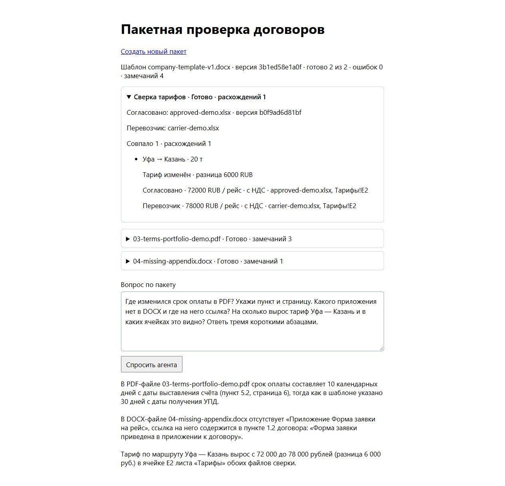
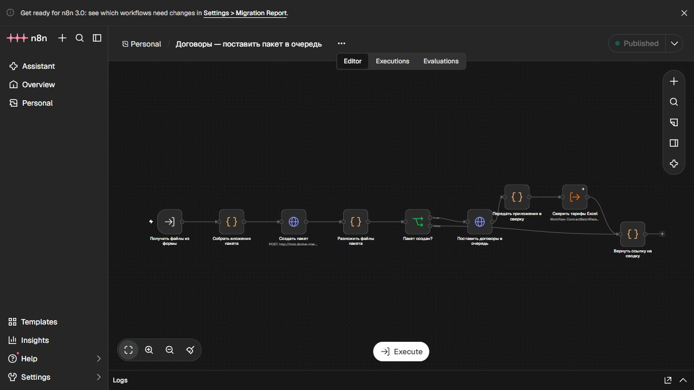
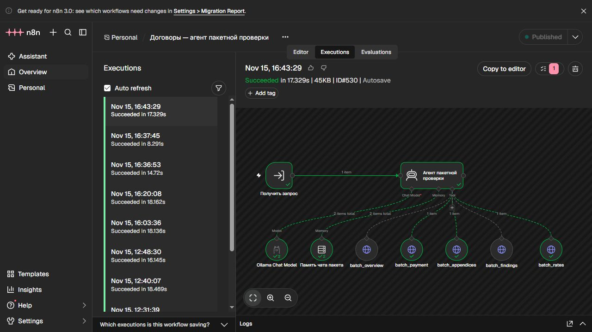

# AI-агент для проверки договоров

Локальный сервис для проверки проектов договоров по шаблону. Принимает один договор или пакет документов, находит изменения условий и помогает подготовить ответ контрагенту. В отчёте видны источники: пункт договора, страница PDF или ячейка Excel.

## Демонстрация

**[▶ Смотреть демо · 54 секунды](assets/contract-review-demo.mp4)**

Загрузка файлов → сводка расхождений → вопрос агенту → черновик письма.

## Что реализовано

- **Одиночная и пакетная загрузка.** Один договор можно проверить через отдельную форму. В пакет можно добавить несколько DOCX и PDF с текстовым слоем и выбрать один шаблон для всех файлов.
- **Шаблоны с версиями.** Шаблон договора и согласованные тарифы загружаются через отдельную форму. Пакет сохраняет выбранные версии, чтобы в отчёте было видно, с чем сравнивали файлы.
- **Сравнение условий.** Сервис ищет аналоги даже при переформулировке и перенумерации пунктов. Отдельно отмечает изменения реквизитов и отсутствующие приложения. При слабом совпадении предлагает проверить выбор шаблона.
- **Сверка тарифов XLSX.** Сравнивает ставки по маршруту и типу машины. В сводке показывает обе суммы, разницу и ячейки источников.
- **Чат и работа с замечаниями.** Можно спросить об одном договоре или обо всём пакете, выбрать замечания для обсуждения и подготовить редактируемый черновик письма.

### Пример из демо

В учебном договоре перевозки срок оплаты сократился с 30 до 10 дней, а отсчёт перенесли с получения УПД на дату выставления счёта. Отчёт показывает обе формулировки и отмечает **п. 5.2, стр. 6 PDF**. В том же пакете можно спросить агента об отсутствующем приложении и расхождении в Excel.

## Как устроен проект

| Стек | Что делает |
| --- | --- |
| **n8n** | Принимает файлы, запускает проверки, вызывает инструменты агента и открывает сводку. |
| **Python · FastAPI** | Извлекает пункты и таблицы, сопоставляет документы и рассчитывает разницу в тарифах. |
| **BGE-M3** | Строит эмбеддинги пунктов для поиска близких формулировок по смыслу. |
| **Ollama · Qwen** | Локально помогает классифицировать изменения и отвечает на вопросы по результатам проверки. |
| **SQLite** | Хранит версии шаблонов, результаты, решения по замечаниям и черновики. |

В основном сценарии **7 workflow n8n**. Основной workflow связывает формы и чат. Шесть дочерних отвечают за проверку вложения, очередь пакетной проверки, сверку Excel, агента по договору, агента по пакету и подготовку черновика.

### Как агент получает ответ

Пакетный агент читает готовую сверку через инструменты n8n. Инструменты возвращают данные об оплате, приложениях и тарифах вместе с источниками. Память чата помогает связать уточнение с предыдущим вопросом.

На скриншоте успешного запуска зелёным отмечены Ollama, память и три вызова: `batch_payment`, `batch_appendices` и `batch_rates`.

[Открыть пример отчёта PDF](assets/demo-pdf-report.jpg) · [Посмотреть черновик письма](assets/demo-draft.jpg)

## Локальный запуск

[Инструкция](SETUP.md) описывает запуск API, импорт workflow n8n и контрольный прогон с учебными документами из `examples`.
